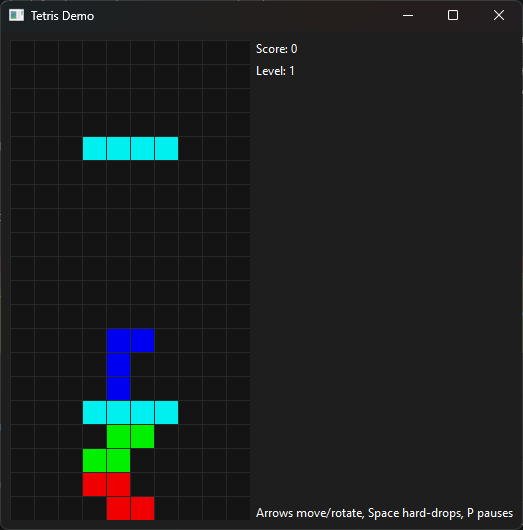

# tetris-demo

A single-player Tetris clone built with PyQt6.



## Running

```bash
pip install -r requirements.txt
python main.py
```

## Controls

| Key          | Action      |
|--------------|-------------|
| Left / Right | Move        |
| Up           | Rotate      |
| Down         | Soft drop   |
| Space        | Hard drop   |
| P            | Pause       |

## Project layout

- `main.py` — entry point.
- `tetris/board.py` — game logic (grid, pieces, rotation, line clears, scoring). No Qt dependency.
- `tetris/widget.py` — PyQt6 rendering and input handling.
- `tests/test_board.py` — unit tests for the game logic.

## Testing

```bash
pip install -r requirements.txt -r requirements-dev.txt
python -m pytest tests/ -v
```
